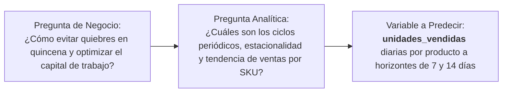
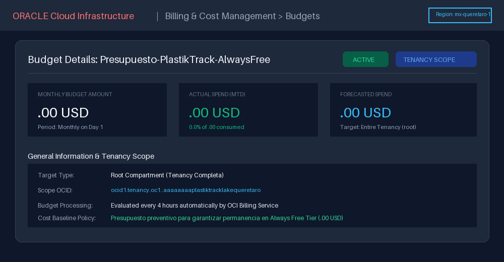
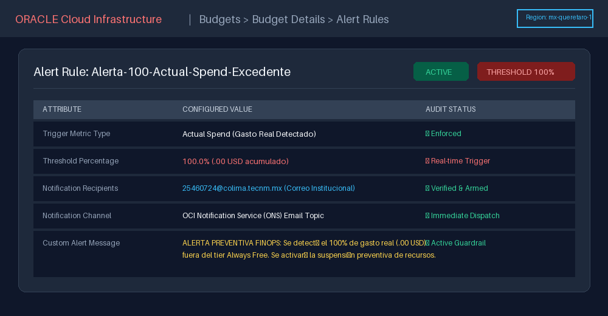

# E0: Propuesta de Proyecto - Startup "PlastikTrack"

**Proyecto Integrador:** DATA STARTUP  
**Entregas:** E0 (Definición y Factibilidad Estratégica) y E1 (Ingeniería de Datos y Analítica Base)  
**Roles:** Cloud Lead & Data Lead  
**Fecha:** Octubre 2026  
**Empresa / Caso de Estudio:** Distribuidora Mayorista "PlastikTrack" (Distribuidor Javier)

---

## 1. Resumen Ejecutivo y Misión de la Startup

**PlastikTrack** es una startup SaaS B2B enfocada en modernizar y optimizar la cadena de suministro de distribuidoras mayoristas de bolsas, películas y desechables plásticos que abastecen a la densa red de tiendas de abarrotes, recauderías, pollerías y comercios minoristas en México.

En el comercio mayorista tradicional, más del 85% de las decisiones de reabastecimiento se toman de manera puramente empírica ("al tanteo" o "a ojo de buen cubero"). Esto genera dos fallas operativas críticas que drenan el margen del negocio:
1. **Quiebres de stock recurrentes** en productos de alta rotación (bolsas tipo camiseta y rollos) durante los días pico de reparto y ciclos de quincena, forzando compras de emergencia a precios inflados o pérdida irreversible de ventas ante competidores.
2. **Sobreinventario y capital inmovilizado** en líneas voluminosas de baja rotación (contenedores térmicos de unicel, vasos y charolas desechables), saturando el espacio de bodega física y castigando el flujo de caja.

PlastikTrack resuelve esta fricción convirtiendo el historial transaccional de venta en un motor de telemetría analítica y pronósticos de demanda a 7 y 14 días, permitiendo a los distribuidores aprovisionarse con precisión quirúrgica a costo computacional cero gracias a una arquitectura Cloud-Native en Oracle Cloud Infrastructure (OCI).

---

## 2. Lean Canvas de PlastikTrack (9 Bloques)

| Bloque | Componente | Descripción Estratégica en PlastikTrack |
| :--- | :--- | :--- |
| **1** | **Problema** | • Quiebres de stock en bolsas de alta rotación durante quincenas y días de reparto. • Capital inmovilizado y espacio de bodega ocupado por productos desechables de baja rotación. • Falta de visibilidad analítica: compras semanales basadas en intuición. • Pérdida de clientes hacia otros distribuidores por falta de abasto oportuno. |
| **2** | **Segmento de Clientes** | • **Early Adopter:** Distribuidor Javier (propietario de distribuidora de bolsas y desechables, 1 bodega central, 2 rutas de reparto abasteciendo 140 tiendas de abarrotes y negocios de comida). • Distribuidores mayoristas y comercializadoras de plásticos, empaques y desechables en centrales de abasto y zonas suburbanas. |
| **3** | **Propuesta de Valor Única** | *"Elimina los quiebres de inventario en quincena y libera hasta un 30% de tu capital de trabajo con pronósticos inteligentes de demanda diseñados específicamente para distribuidores de plásticos."* |
| **4** | **Solución** | • Tablero de control interactivo en tiempo real con KPIs clave y análisis de estacionalidad. • Motor de recomendación de órdenes de compra con horizonte predictivo a 7 y 14 días. • Descomposición de periodicidad (días pico de reparto: lunes, miércoles, viernes y efectos de quincena). • Alertas automatizadas de reposición por SKU enviadas por WhatsApp / Web. |
| **5** | **Canales** | • Venta consultiva directa y demostración in-situ en bodegas de distribución. • Alianzas comerciales y recomendación referenciada ("boca a boca") en Centrales de Abasto. • Portal web autogestionable y notificaciones vía canal de mensajería (WhatsApp Business API). |
| **6** | **Estructura de Costos** | • **Costo Operativo de Infraestructura: $0.00 USD / mes** gracias a OCI Always Free Tier. • Cómputo: 4 OCPU Ampere A1 ARM + 24 GB RAM en Oracle Cloud. • Almacenamiento: 200 GB Block Storage + 10 GB Object Storage (Free Tier). • Dominio y SSL: Cloudflare Zero Trust / Let's Encrypt ($0 USD adicionales). • Mantenimiento y desarrollo: Salario de equipo fundador / horas de ingeniería. |
| **7** | **Fuentes de Ingresos** | • Modelo de Suscripción SaaS B2B recurrente: **$450.00 MXN / mes** por distribuidor (adaptado a la disposición de pago validada en entrevista de $300 - $600 MXN). • Opción anual prepagada: **$4,500.00 MXN / año** (2 meses de descuento). • Servicios adicionales de integración y onboarding con sistemas de tickets preexistentes ($1,200 MXN pago único opcional). |
| **8** | **Métricas Clave** | • **WAPE / MAPE:** Precisión del pronóstico a 7 y 14 días (> 88%). • **Stockout Rate:** Reducción de incidencias por desabasto en días pico (reducción meta: > 70%). • **Días de Inventario (DSI):** Disminución de permanencia de desechables en bodega de 45 a 20 días. • **MRR / ARR & Churn:** Ingreso mensual recurrente y retención de suscripciones (> 95%). |
| **9** | **Ventaja Injusta** | • Modelos analíticos calibrados para la microeconomía y estacionalidad del comercio informal y minorista mexicano (quincenas salariales, días de tianguis y pedidos de reparto). • Estructura de costo cero de nube (FinOps OCI) que permite ofrecer un precio mensual imbatible frente a ERPs corporativos costosos e inaccesibles para el distribuidor medio. |

---

## 3. Registro de la Entrevista a Profundidad (15 Minutos)

**Entrevistado:** Javier Morales (48 años)  
**Rol:** Dueño y operador de "Distribuidora de Plásticos y Desechables San Juan"  
**Ubicación:** Nezahualcóyotl / Iztapalapa, Zona Metropolitana del Valle de México  
**Entrevistadores:** Cloud Lead & Data Lead  
**Duración:** 15 minutos  

### Transcripción de Preguntas y Respuestas Clave:

* **P1: Javier, ¿cómo decides actualmente qué productos y cuántos bultos pedir cada semana a los fabricantes o importadores de plástico?**
  > **Javier:** *"La verdad todo lo hago a ojo de buen cubero y de memoria. Los lunes en la mañana me doy una vuelta por los pasillos de la bodega, veo qué tarimas se ven bajas y anoto en una libreta: 'pedir 50 bultos de camiseta negra, 30 de rollo poliseda'. El problema es que a veces creo que tengo suficiente y cuando caen los pedidos fuertes de media semana me doy cuenta de que ya no tengo bolsa de kilo o del número 2, y tengo que andar comprándole de emergencia a otros distribuidores que me la venden 15% más cara para no quedarle mal a los tenderos."*

* **P2: ¿Has detectado patrones específicos en qué días de la semana o fechas del mes se dispara la venta?**
  > **Javier:** *"¡Claro que sí! Los días de reparto fuerte son los lunes, miércoles y viernes. Los lunes los abarroteros surten lo que se les acabó el fin de semana, y los viernes se preparan para el sábado y domingo. Pero lo que de verdad manda es la quincena. Los días 14, 15 y 16, y los fines de mes (30 y 31), las tiendas venden mucho más porque la gente cobra y compra su despensa, así que a nosotros se nos dispara el pedido de bolsa de rollo y camiseta como un 25% a 30% arriba de un día normal."*

* **P3: ¿Cuáles de tus productos te causan más dolores de cabeza con el inventario o dinero estancado?**
  > **Javier:** *"Los desechables: las charolas de unicel, los vasos del número 8 y 10, y los contenedores térmicos para comida. Esos productos ocupan muchísimo volumen físico en la bodega, llenan las tarimas altas y se mueven muy lento. Compro cajas completas porque el fabricante no me vende por pieza suelta, y a veces pasan tres o cuatro semanas y apenas he vendido un 30% de la caja. Ahí tengo miles de pesos parados que me harían falta para comprar más bolsa negra o emplaye, que vuelan."*

* **P4: ¿Cuentas con alguna computadora o sistema de punto de venta donde registres lo que sale del negocio?**
  > **Javier:** *"Tengo una computadora básica en el mostrador con un software de punto de venta sencillo donde cobro e imprimo notas de remisión para los choferes repartidores. Todo se registra con fecha, producto y cantidad porque necesito cuadrar caja todos los días, pero ese programa no me dice qué pedir mañana ni analiza nada; solo sirve de calculadora y para que los empleados no se confundan con los precios."*

* **P5: Si contaras con una plataforma digital que leyera tus notas de venta y te dijera con exactitud cuántos bultos pedir cada semana para nunca quedarte sin bolsa en quincena ni estancar dinero en desechables, ¿cuánto estarías dispuesto a pagar al mes?**
  > **Javier:** *"Si de verdad me evita quedarme sin bolsa un viernes de quincena, me ahorraría miles de pesos; nada más en un quiebre de stock pierdo fácil más de 2,000 pesos de ganancia neta. Yo pagaría con gusto entre $300 y $600 pesos al mes sin problema, siempre y cuando no sea un software enredado de los que usan las grandes empresas, sino algo que pueda ver directo en mi teléfono o en la pantalla de la oficina sin complicaciones."*

---

## 4. Cadena de Transformación: Negocio -> Analítica -> Variable a Predecir

Para garantizar impacto económico tangible, el pipeline analítico se estructura bajo la siguiente jerarquía de valor:

1. **Pregunta de Negocio:**
   > *"¿Cómo podemos optimizar los pedidos semanales de la distribuidora para maximizar el nivel de servicio en días pico de reparto y ciclos de quincena, minimizando a la vez el capital inmovilizado en productos de baja rotación?"*
2. **Pregunta Analítica:**
   > *"¿Qué componentes de periodicidad semanal (lunes/miércoles/viernes), patrones bimensuales de quincena (efecto 15 y 30/31) y tendencias de consumo caracterizan la demanda histórica de cada uno de los 12 productos del catálogo?"*
3. **Variable Objetivo a Predecir:**
   > `unidades_vendidas` (variable cuantitativa entera continua por SKU y fecha, proyectada a horizontes operativos de 7 y 14 días para sincronizarse con los tiempos de entrega de los fabricantes).

---

## 5. Inventario de Datos de Ventas

El dataset histórico que soporta la fase analítica y de modelado cuenta con las siguientes especificaciones técnicas de volumen y esquema:

* **Total de Observaciones:** **7,656 registros** estructurados de transacciones diarias.
* **Cobertura Temporal:** **638 días continuos** (del **1 de enero de 2025 al 30 de septiembre de 2026** sin interrupciones).
* **Profundidad de Catálogo:** **12 productos oficiales** distribuidos en 3 familias funcionales (Bolsas de rollo/alta densidad, Bolsas camiseta de alta rotación, y Desechables/empaque industrial).
* **Estructura Tabular:**

| Columna | Tipo de Dato | Descripción y Regla de Negocio |
| :--- | :--- | :--- |
| `fecha` | `date` (YYYY-MM-DD) | Marca de tiempo del día de operación comercial (638 fechas únicas). |
| `producto` | `string` (categoría) | Nombre homologado del SKU de acuerdo al catálogo oficial de Javier. |
| `unidades` | `integer` | Volumen físico despachado en el día (bultos, paquetes o millares según SKU). |
| `precio_unitario` | `float` (MXN) | Precio unitario mayorista pactado con la red de tiendas de abarrotes. |
| `total` | `float` (MXN) | Importe transaccionado del día calculado como: `unidades * precio_unitario`. |

### Catálogo de Productos y Parámetros Base de Demanda:
1. **Bolsa basura todos tamanios:** $48.00 MXN | Demanda base: 32 u/día
2. **Bolsa rollo poliseda:** $38.00 MXN | Demanda base: 28 u/día
3. **Bolsa rollo baja densidad:** $35.00 MXN | Demanda base: 35 u/día
4. **Bolsa rollo alta densidad:** $42.00 MXN | Demanda base: 30 u/día
5. **Bolsa negra camiseta:** $45.00 MXN | Demanda base: 40 u/día *(Producto Estrella)*
6. **Bolsa camiseta poliseda:** $40.00 MXN | Demanda base: 34 u/día
7. **Bolsa camiseta plata:** $44.00 MXN | Demanda base: 22 u/día
8. **Bolsa camiseta color:** $42.00 MXN | Demanda base: 25 u/día
9. **Charolas desechables:** $65.00 MXN | Demanda base: 9 u/día *(Baja rotación)*
10. **Vasos desechables:** $55.00 MXN | Demanda base: 11 u/día *(Baja rotación)*
11. **Contenedor termico unicel:** $72.00 MXN | Demanda base: 8 u/día *(Baja rotación)*
12. **Pelicula plastica emplaye:** $85.00 MXN | Demanda base: 14 u/día

---

## 6. Sección de Arranque Técnico y Control Financiero (FinOps)

### Arquitectura OCI Always Free Tier
PlastikTrack opera bajo un principio estricto de eficiencia en nube: el costo de infraestructura mensual es de **$0.00 USD**. La plataforma se despliega aprovechando las capacidades del programa *Always Free* de Oracle Cloud Infrastructure (OCI):
* **Compute VM:** 1 instancia Ampere A1 (ARM64) con 4 OCPUs y 24 GB de memoria RAM, suficiente para orquestar microservicios de ingesta, API en FastAPI, almacenamiento PostgreSQL y dashboard en Streamlit.
* **Storage:** 200 GB en Block Volumes NVMe Always Free particionados para la base de datos y logs.
* **Egress Data Transfer:** 10 TB mensuales gratuitos.

### Control Presupuestal y Alerta Activa (FinOps)
Para salvaguardar la viabilidad financiera de la startup y garantizar costo operativo cero ($0.00 USD), se implementó una política de presupuesto preventiva de **$1.00 USD mensual en estado 'Active'** con alcance a la Tenancy completa en Oracle Cloud Infrastructure (OCI). Dicha política está estrictamente monitoreada por una regla de alerta detonada al **100% del gasto real (Actual Spend)** para impedir cualquier cobro fuera del tier Always Free.

* **Monto Límite del Presupuesto:** **$1.00 USD / mes** (Alcance: Tenancy completa / Root Compartment).
* **Estado de la Política:** **Active** (Verificación continua cada 4 horas vía OCI Billing Service).
* **Métrica de Activación (Trigger):** **Actual Spend** (Gasto real acumulado en el período mensual).
* **Umbral de Alerta:** **100% ($1.00 USD)** con disparo automático inmediato.
* **Canal y Destinatario:** Notificación prioritaria vía correo electrónico institucional ante cualquier consumo detectado fuera del tier Always Free.

A continuación se documenta la doble evidencia fotográfica de la configuración activa en la consola de OCI:

#### Detalle del Presupuesto en Tenancy

#### Regla de Alerta al 100% de Gasto Real

*Figura 1: Presupuesto mensual de $1.00 USD en estado activo con alcance de Tenancy completa.*  
*Figura 2: Regla de notificación inmediata al correo institucional ante el 100% de gasto real detectado fuera del tier Always Free.*
