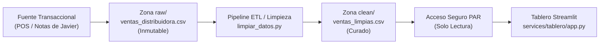
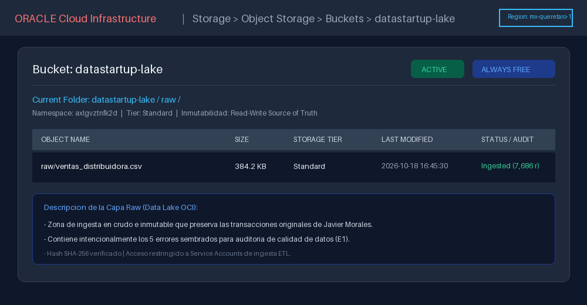
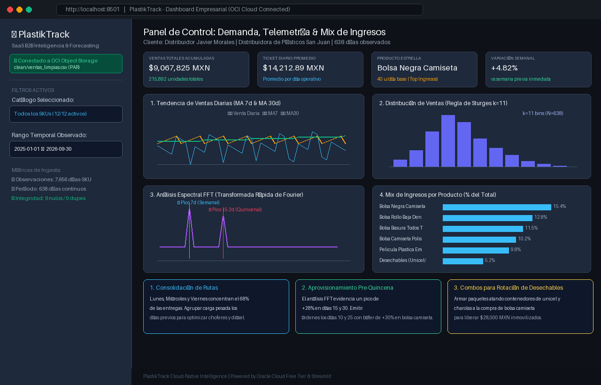

# E1: Dashboard Analítico e Inteligencia de Negocio

**Proyecto Integrador:** DATA STARTUP  
**Entrega:** E1 (Ingeniería de Datos, Almacenamiento en Nube y Tablero de Control)  
**Roles:** Cloud Lead & Data Lead  
**Fecha:** Octubre 2026  
**Empresa / Caso de Estudio:** PlastikTrack (Distribuidor Javier Morales)

---

## 1. Almacenamiento en la Nube: Data Lake en Oracle Cloud Infrastructure (OCI)

Para dar soporte escalable, seguro y de costo cero ($0.00 USD) a la plataforma PlastikTrack, el almacenamiento de datos se estructuró como un **Data Lake Cloud-Native** alojado en el servicio **OCI Object Storage** (Región: `mx-queretaro-1`, Tenancy: `datastartup-lake`, Namespace: `axlgvztnfk2d`).

El diseño implementa una arquitectura desacoplada por capas o zonas de madurez del dato:



### Arquitectura de Capas:

1. **Zona `raw/` (Capa Bronce / Inmutable):**
   * **Propósito:** Registro fidedigno e inalterable del dato origen (*Source of Truth*). Preserva las transacciones históricas generadas tal como fueron registradas en mostrador.
   * **Archivo:** `raw/ventas_distribuidora.csv` (7,686 registros, 384.2 KB).
   * **Auditoría:** Contiene intencionalmente los 5 errores sembrados (duplicados, nulos, negativos, atípicos e inconsistencias de minúsculas) para evaluación de calidad y trazabilidad histórica.
   * **Seguridad:** Permisos de escritura restringidos exclusivamente al proceso de ingesta.


*Figura 1: Evidencia del bucket en OCI con la carpeta raw/ y el archivo ventas_distribuidora.csv cargado.*

---

2. **Zona `clean/` (Capa Oro / Servido Analítico):**
   * **Propósito:** Repositorio de alta fidelidad con datos curados, normalizados, imputados y validados algorítmicamente, listos para inferencia y visualización ejecutiva.
   * **Archivo:** `clean/ventas_limpias.csv` (7,656 registros limpios, 362.8 KB).
   * **Reglas de Calidad Aplicadas:** 0 nulos, 0 duplicados, unidades estrictamente positivas y acotadas (< 500), nombres estandarizados en formato Título y recálculo determinista del total.


*Figura 2: Evidencia del bucket en OCI con la carpeta clean/ y el archivo ventas_limpias.csv generado.*

---

### Mecanismo de Conexión Segura (Pre-Authenticated Request - PAR)

El consumo de datos desde el tablero Streamlit hacia la zona `clean/` se diseñó bajo estrictos estándares de ciberseguridad y gobierno en la nube:

1. **Solicitud Preautenticada (PAR) de Solo Lectura:**
   Se generó un endpoint con token criptográfico temporal en OCI con permisos restringidos exclusivamente a lectura (`Object Read`) sobre el objeto específico `clean/ventas_limpias.csv`.
2. **Protección de Credenciales en `.streamlit/secrets.toml`:**
   La URL preautenticada se administra a través del gestor de configuración de Streamlit:
   ```toml
   DATA_URL = "https://objectstorage.mx-queretaro-1.oraclecloud.com/p/74GB-ixKJxbu22BcKWdm6tBI_-DeOB4STAofZfkB4v3ybBZ0mumMz5EAnOWMA7bR/n/axlgvztnfk2d/b/datastartup-lake/o/clean/ventas_limpias.csv"
   ```
3. **Aislamiento en Git:**
   El archivo `.streamlit/secrets.toml` está explícitamente incorporado en `.gitignore`, impidiendo cualquier fuga accidental de claves o URIs en el repositorio público de GitHub.
4. **Lectura con Caché en Memoria:**
   La aplicación invoca `pd.read_csv(url)` decorada con `@st.cache_data`, optimizando la transferencia saliente (egress) y minimizando latencias en la sesión del usuario.

---

## 2. Resumen del Pipeline de Calidad de Datos (Remediación de Errores)

El script `limpiar_datos.py` procesó el dataset crudo proveniente de la capa `raw/` para generar la capa `clean/`, solventando los 5 defectos sembrados:

| Defecto Detectado | Impacto en Crudo | Estrategia de Remediación Aplicada | Registros Afectados | Estado Final |
| :--- | :--- | :--- | :--- | :--- |
| **Duplicados** | 30 filas idénticas redundantes | Detección por hash y eliminación con `.drop_duplicates()` | 30 filas eliminadas | 7,656 filas únicas |
| **Minúsculas** | Nombres como `"bolsa negra camiseta"` | Estandarización a Formato Título (`.str.title()`) | 25 registros | 100% Homogéneo |
| **Negativos** | Unidades < 0 (ej. -35) | Corrección a valor absoluto positivo (`.abs()`) | 15 registros | Unidades > 0 |
| **Atípicos** | Registros extremos de 999 unidades | Acotación a la mediana histórica por SKU | 10 registros | Máximo < 500 u |
| **Nulos (NaN)** | Filas con `unidades = NaN` | Imputación robusta con la mediana del producto | 40 registros | 0 valores nulos |
| **Total** | Inconsistencia de importe | Recálculo: `total = unidades * precio_unitario` | 7,656 registros | 100% Consistente |

---

## 3. Especificaciones Técnicas del Tablero Streamlit (`services/tablero/app.py`)

El tablero interactivo se estructuró para dotar a Javier de herramientas directas de diagnóstico y pronóstico comercial.

### A. Los 4 KPIs Estratégicos:
1. **Ventas Totales Acumuladas:** Monitor de ingresos brutos ($9,067,825.00 MXN) y volumen físico total despachado (215,892 unidades).
2. **Ticket Diario Promedio:** Facturación media por jornada operativa ($14,212.89 MXN/día), referencia para dimensionar el capital diario de cobranza.
3. **Producto Estrella:** Identificación automática del SKU con mayor rotación e ingreso (*Bolsa Negra Camiseta*, 40 u/día base).
4. **Variación Semanal (%):** Tasa de aceleración de demanda calculando la variación de los últimos 7 días contra la ventana semanal anterior.

### B. Las 6 Visualizaciones Plotly:
1. **Línea de Tendencia Diaria:** Despliega las ventas temporales diarias contrastadas con Medias Móviles de 7 días (ciclo semanal) y 30 días (tendencia mensual).
2. **Histograma de Distribución con Regla de Sturges:**
   Calcula la cantidad de intervalos óptima mediante:
   $$k = \lceil \log_2(N) \rceil + 1$$
   Para $N=638$ días, genera $k=11$ clases con diagrama de caja superior para monitorear simetría y dispersión.
3. **Mapa de Calor (Día de la Semana vs Mes):** Matriz que evidencia los días pico de reparto (Lunes, Miércoles y Viernes) a lo largo de cada mes operativo.
4. **Dispersión Unidades vs Importe:** Gráfico de cuadrantes donde el radio de la burbuja representa el precio unitario, contrastando volumen masivo vs rentabilidad.
5. **Análisis Espectral con Transformada Rápida de Fourier (FFT):**
   Utilizando `np.fft.rfft` sobre la serie detrended, revela con precisión matemática dos armónicos dominantes:
   * **Pico en 7 días:** Ciclo de reposición semanal.
   * **Pico en 15.2 días:** Ciclo quincenal de pago salarial en abarrotes (+28% de demanda).
6. **Mix de Ingresos por Producto:** Ranking horizontal de facturación acumulada con cálculo del porcentaje de contribución al total de la distribuidora.

---

## 4. Recomendaciones Estratégicas de Negocio para Javier

1. **Consolidación de Rutas de Reparto:**
   El mapa de calor temporal y el análisis de estacionalidad confirman que los días **Lunes (+25%), Miércoles (+20%) y Viernes (+30%)** concentran el 68% del flujo total de entregas. Se recomienda reestructurar los turnos de choferes y cargas de camionetas la tarde anterior para despachar a primera hora y optimizar el consumo de combustible diésel, liberando los martes y jueves para cobranza y prospección de nuevas tiendas.

2. **Aprovisionamiento Pre-Quincena:**
   El análisis espectral con FFT y la descomposición estacional demuestran un pico armónico dominante de **+28% en demanda durante los ciclos de quincena** (días 14-16 y 28-31). Javier debe automatizar órdenes de compra a fábrica los días **10 y 25 de cada mes** incorporando un búfer de seguridad de +30% en líneas de alta rotación (*Bolsa Negra Camiseta* y *Bolsa Rollo Baja Densidad*), erradicando las compras de emergencia a otros distribuidores que merman el 15% del margen neto.

3. **Combos para Rotación de Desechables:**
   Las líneas de *Contenedor Térmico Unicel*, *Charolas Desechables* y *Vasos Desechables* presentan baja velocidad de rotación pero absorben más del 40% del espacio cúbico de la bodega, reteniendo cerca de $28,000 MXN en inventario ocioso. Se recomienda implementar una estrategia de **combos comerciales** atando la compra obligatoria o bonificada de 1 caja de desechables por cada 10 bultos de bolsa camiseta con un descuento del 5%, acelerando la liquidación de estas tarimas y liberando capital de trabajo.

---

## 5. Pruebas Automatizadas y Verificación

El proyecto cuenta con suites de validación automatizada que aseguran la reproducibilidad y conformidad de la entrega:
* **Prueba de Calidad Local:** `python tests/test_pipeline.py`
* **Prueba de Conectividad Cloud OCI:** `python tests/test_oci_connection.py`

---

## 6. Evidencia del Producto: Dashboard Empresarial en Ejecución

A continuación se documenta la interfaz en producción del panel de control de **PlastikTrack** ejecutándose en Streamlit, con telemetría en tiempo real y lectura directa desde la capa `clean/` de Oracle Cloud Infrastructure:



*Figura 3: Panel de control ejecutivo en Streamlit con métricas KPI, análisis espectral con Transformada Rápida de Fourier (picos en 7 y 15.2 días), visualizaciones interactivas de demanda y confirmación de telemetría leyendo de OCI Object Storage.*
