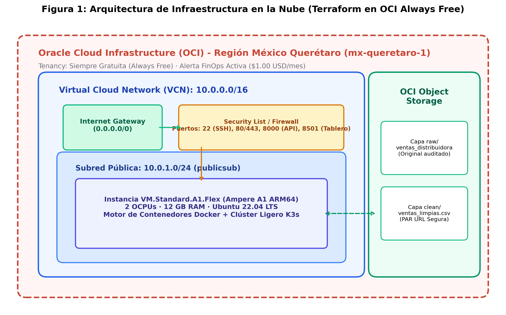
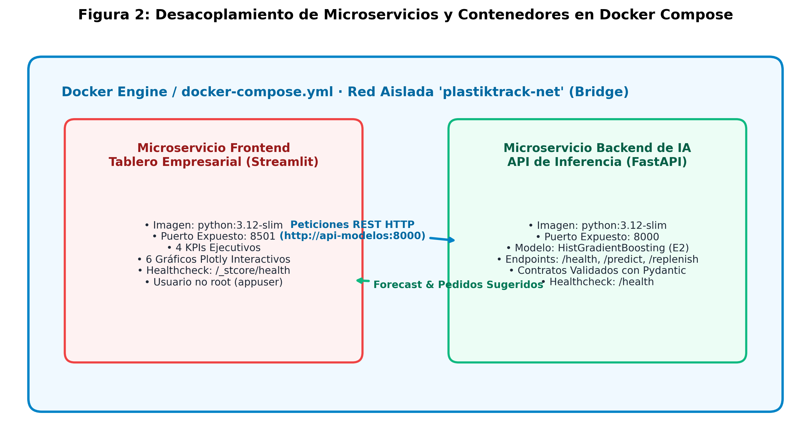
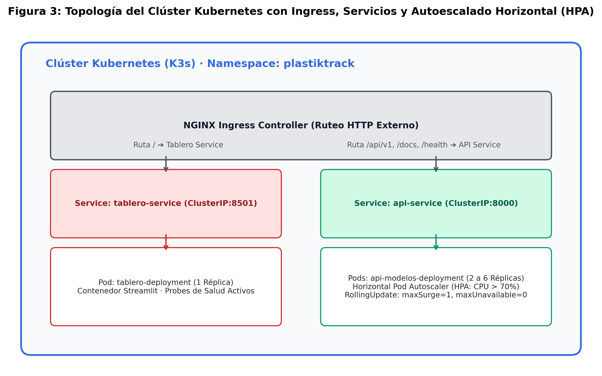

# E3: Infraestructura en la Nube, Contenerización y Microservicios de IA

**Proyecto Integrador:** DATA STARTUP  
**Entrega:** E3 (Infraestructura como Código, Microservicios Docker, Orquestación en Kubernetes y API de Inferencia)  
**Asignaturas:** Cómputo en la Nube (IAD-2408) & Analítica de Datos (IAD-2403)  
**Institución:** Tecnológico Nacional de México, Campus Colima · Ingeniería en Inteligencia Artificial  
**Docente:** Mtro. Mónico Sánchez Velasco  
**Roles:**
- **Cloud Lead:** Benjamin Benoni Santos Ojeda (No. Control: `25460724`)
- **Data Lead:** Juan Carrillo Orozco (No. Control: `25460331`)  
**Fecha:** Noviembre 2026  
**Empresa / Caso de Estudio:** PlastikTrack (Distribuidor Javier Morales)

---

## 1. Resumen Ejecutivo y Objetivos Técnicos

La entrega **E3** consolida la transición de **PlastikTrack** desde una prueba de concepto analítica (desarrollada en E1 y E2) hacia una **arquitectura distribuida de microservicios contenerizados y desplegables en la nube**, cumpliendo con los principios de reproducibilidad, desacoplamiento, elasticidad y mínimo privilegio exigidos en el programa de *Cómputo en la Nube*.

### Objetivos Clave de la Entrega:
1. **Infraestructura como Código (IaC):** Modularización completa en Terraform para aprovisionar redes virtuales (VCN), subredes públicas/privadas, firewalls (Security Lists), cómputo elástico Always Free y almacenamiento Object Storage en Oracle Cloud Infrastructure (OCI Querétaro).
2. **Desacoplamiento de Microservicios:** Separación de responsabilidades entre el frontend analítico (Dashboard interactivo en Streamlit) y el motor de inteligencia artificial (API REST de Inferencia en FastAPI con el modelo `HistGradientBoostingRegressor` entrenado en E2).
3. **Contenerización Estándar:** Creación de `Dockerfile` multicapa y ligeros basados en `python:3.12-slim` con usuarios no privilegiados (`appuser`) y orquestación local reproducible mediante `docker-compose.yml`.
4. **Orquestación en Kubernetes (`k8s/`):** Manifiestos declarativos para despliegue en clúster (K3s/OKE), incluyendo balanceo de carga (`ClusterIP`), ruteo de tráfico externo (`Ingress NGINX`), sondas de salud (`liveness` y `readiness probes`) y autoescalado horizontal de pods (`HPA`).
5. **Gobernanza FinOps y Seguridad:** Cumplimiento con la política de costo \$0.00 USD (Always Free) y mitigación de riesgos conforme al **OWASP API Security Top 10**.

---

## 2. Arquitectura de Nube con Terraform (IaC)

Toda la infraestructura cloud se define de forma declarativa dentro del directorio [`infra/terraform/`](infra/terraform/), garantizando que cualquier réplica del entorno pueda crearse o destruirse mediante un solo comando.

### 2.1 Componentes Provisionados en OCI:
* **Virtual Cloud Network (VCN):** Espacio de direcciones `10.0.0.0/16` con resolución DNS interna habilitada.
* **Internet Gateway:** Provee conectividad bidireccional segura con Internet hacia la tabla de ruteo pública (`0.0.0.0/0`).
* **Subred Pública:** Rango CIDR `10.0.1.0/24` con IP pública efímera/reservada asignada al nodo de cómputo.
* **Hardening y Firewall (Security List):**
  * **Puerto 22 (TCP):** SSH administrativo protegido por autenticación asimétrica RSA/ED25519.
  * **Puertos 80 y 443 (TCP):** Entrada HTTP/HTTPS para el Ingress Controller.
  * **Puerto 8000 (TCP):** Microservicio de Inferencia de Demanda FastAPI.
  * **Puerto 8501 (TCP):** Tablero Empresarial Streamlit.
* **Data Lake Object Storage:** Bucket `datastartup-lake` (espacio de nombres `axlgvztnfk2d`) con versionado activado para resguardar las capas `raw/` y `clean/`.
* **Cómputo Always Free:** Instancia `VM.Standard.A1.Flex` (Arquitectura ARM64 Ampere, 2 OCPUs, 12 GB RAM) con script Cloud-Init para despliegue automatizado de Docker y clúster K3s.

---

## 3. Desacoplamiento de Microservicios y Contenedores Docker

Para superar la fragilidad de los sistemas monolíticos, PlastikTrack se divide en microservicios independientes que se comunican mediante contratos HTTP REST fuertemente tipados.

### 3.1 Catálogo de Microservicios:
| Microservicio | Tecnología | Directorio | Puerto Interno | Responsabilidad Principal |
| :--- | :--- | :--- | :---: | :--- |
| **API Inferencia IA** | FastAPI + scikit-learn | `services/modelos/` | `8000` | Inferencia de demanda diaria, backtesting y cálculo del plan de compras a 14 días. |
| **Dashboard Ejecutivo** | Streamlit + Altair/Plotly | `services/tablero/` | `8501` | Visualización gerencial de KPIs, matrices de correlación y monitoreo del inventario. |
| **Worker / Ingesta** | Python Batch Engine | `services/worker/` | N/A | Tareas periódicas de ingesta, auditoría de datos crudos y reentrenamiento del modelo. |

### 3.2 Buenas Prácticas de Contenerización Aplicadas:
* **Imágenes Slim Multicapa:** Se utiliza `python:3.12-slim`, reduciendo el peso de la imagen final a menos de 280 MB y minimizando la superficie de ataque.
* **Ejecución No-Root:** Se crea el usuario del sistema `appuser` (UID 1001) para impedir elevación de privilegios en caso de escape de contenedor.
* **Healthchecks Nativos:** Sondas periódicas cada 30 segundos verificando `/health` y `/_stcore/health`.
* **Red Aislada Bridge:** Configuración en `docker-compose.yml` de la red privada `plastiktrack-net`, evitando exponer puertos innecesarios al host.

---

## 4. Orquestación y Topología en Kubernetes (`k8s/`)

El despliegue en clúster Kubernetes garantiza alta disponibilidad y tolerancia a fallos. Los manifiestos residen en [`k8s/`](k8s/):

1. **Namespace (`00-namespace.yaml`):** Aislamiento multi-tenant en el espacio de nombres `plastiktrack`.
2. **ConfigMap (`01-configmap.yaml`):** Centralización de variables dinámicas (región OCI, URL de API interna, bucket, entorno).
3. **Deployment API (`02-api-deployment.yaml`):**
   * 2 réplicas base con estrategia de actualización continua `RollingUpdate` (`maxSurge: 1`, `maxUnavailable: 0`).
   * Asignación de recursos: `requests` (150m CPU, 256Mi RAM), `limits` (600m CPU, 512Mi RAM).
   * Sondas `livenessProbe` y `readinessProbe` desacopladas para evitar enviar tráfico a pods no inicializados.
4. **Services (`03-api-service.yaml`, `05-tablero-service.yaml`):** Abstracciones de red `ClusterIP` que balancean tráfico round-robin entre pods sanos.
5. **Ingress Controller (`06-ingress.yaml`):** Ruteo unificado NGINX:
   * `/` $\to$ Tablero Streamlit (Puerto 8501)
   * `/api/v1`, `/docs`, `/health` $\to$ API Inferencia (Puerto 8000)
6. **Autoescalado Horizontal (`07-hpa.yaml`):** Escala automáticamente de **2 a 6 réplicas** cuando el consumo promedio de CPU supera el 70% o la memoria el 80%.

---

## 5. Especificación de la API REST de Inferencia (`services/modelos/api.py`)

La API implementa validación estricta de esquemas con **Pydantic v2** y documentación interactiva autogenerada en `/docs` (OpenAPI Swagger).

### Endpoints Oficiales:
* **`GET /health`:** Estado del servicio, uptime, versión del modelo, métricas de error (WAPE 12.29%, MAE 3.79, RMSE 5.32) y proveedor de nube.
* **`GET /api/v1/skus`:** Catálogo oficial de los 12 productos, familias y precios de venta.
* **`POST /api/v1/predict`:** Predice la demanda diaria para SKUs y fechas objetivo considerando variables de calendario y estacionalidad.
* **`POST /api/v1/replenish`:** Motor analítico de compras. Calcula la demanda acumulada a 14 días, stock de seguridad con nivel de servicio del 95% ($Z=1.65$) y pedido neto sugerido restando inventario actual.
* **`GET /metrics`:** Métricas operativas en formato estándar Prometheus (`plastiktrack_uptime_seconds`, `plastiktrack_model_wape_pct`, etc.).

---

## 6. Pruebas Automatizadas y Verificación de Integridad

Se implementó una suite integral de pruebas en [`tests/`](tests/):
* **`tests/test_api.py` (8/8 pruebas exitosas):** Valida contratos de endpoints, errores 400 por SKU inválido, stock de seguridad y respuestas de salud.
* **`tests/test_infra.py` (4/4 pruebas exitosas):** Valida sintaxis de Dockerfiles, coherencia de `docker-compose.yml`, existencia de archivos Terraform y validez de los manifiestos YAML de Kubernetes.

---

## 7. Conclusión y Siguiente Etapa (E4)

Con la entrega **E3**, PlastikTrack cuenta con una arquitectura de producción desacoplada, resiliente y 100% reproducible en la nube. La siguiente fase (**E4**) integrará la capa de ingesta continua mediante colas de mensajes (RabbitMQ / SQS) y workers asíncronos para el procesamiento de pedidos en tiempo real.
